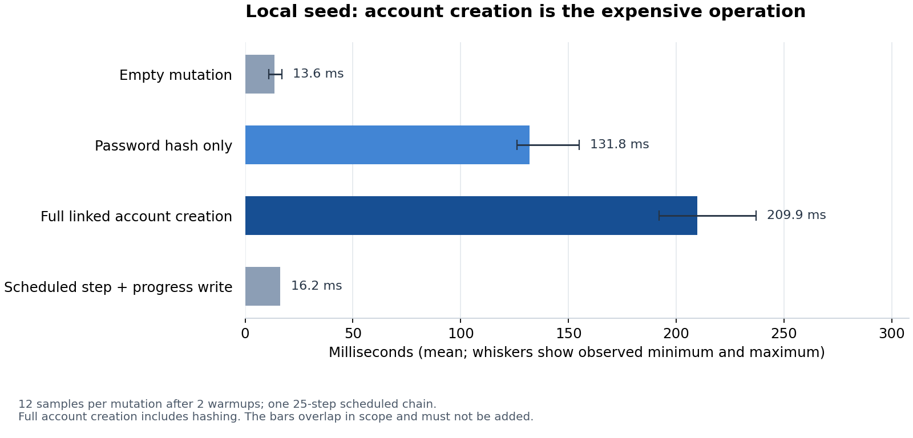
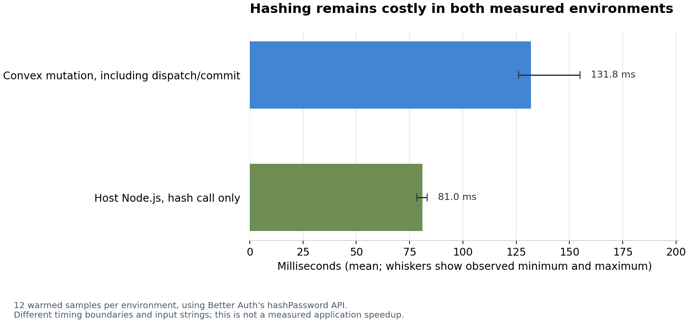

# Local seed timing: measured costs and next steps

The development seed completed in **48.900 seconds** for 50 students and 119
staff. Follow-up measurements identify repeated authentication-account creation,
particularly password hashing, as the largest measured cost. File size does not
explain this workload: the seed builds linked auth/app records and maintains
indexes and counters through scheduled transactions.

This report records an investigation, not an implemented optimization. It is
stacked on [PR #186](https://github.com/virajdas/ia-app/pull/186). The measurement
checkout was `ui/restore-audit` at `41b7a885`; the report branches from the
published PR head `26a0263c`. The seed, auth configuration, account-creation
helper, and counter behavior discussed here match that parent; the measurement
checkout also contained unrelated Home/widget changes.

## What was measured

The original seed ran on a new isolated local Convex deployment. Its recorded
start and completion times were `1793301843019` and `1793301891919` milliseconds.
It reported `COMPLETE` with no error. Deployment creation, environment setup,
bundling, and the schema push are outside the 48.900-second seed interval.

The follow-up benchmark ran against that local deployment on port 3212. The
environment was macOS/ARM64, Convex 1.46.0, Better Auth 1.6.22, and Node 24.22.1.
The original seed was not reset for the benchmark. The complete raw samples,
timing boundaries, versions, and cleanup snapshots are in
[measurements.json](seed-benchmark-2026-10-29/measurements.json).

| Operation | Samples | Mean | Median | Observed range |
| --- | ---: | ---: | ---: | ---: |
| Empty mutation | 12 | 13.58 ms | 14.0 ms | 11–17 ms |
| Password hash only | 12 | 131.83 ms | 129.5 ms | 126–155 ms |
| Full linked account creation | 12 | 209.92 ms | 205.5 ms | 192–237 ms |
| Scheduled step with a progress write | 25 steps, one chain | 16.16 ms/step | — | 404 ms for the chain |



Each mutation measurement follows two warmups. A Convex action measures elapsed
wall time around an awaited mutation, including dispatch and transaction commit.
The mutation itself does not time its work with `Date.now()`: time is fixed
within a mutation. No-op timings provide a baseline for the invocation overhead.

The scheduler test starts a chain of 25 zero-delay scheduled mutations. Each
writes progress, as the real seed does. Its elapsed interval runs from the
initial enqueue transaction's timestamp to the last scheduled mutation's
timestamp. Status polling is excluded. This single chain is a coarse measure,
not a distribution of scheduler latency under different loads.

Full account creation calls the same `createLinkedUser` helper as the seed. It
includes uniqueness checks, Better Auth user/account creation, password hashing,
application-user insertion, and user-counter maintenance. The hash-only test
uses Better Auth's normal `hashPassword` on the same demo password. These
measurements overlap in scope and must not be added.

At the sample means, 169 account creations extrapolate to about **35.5 seconds**.
169 scheduled steps extrapolate to about **2.7 seconds**. This helps explain the
original runtime, but is not a reconstruction of it: the runs happened at
different times, and the full seed has additional transactions and fixture work.
The benchmark does not separately time every component-adapter call, counter
write, transaction commit, or original phase. It also does not measure concurrent
account creation, optimized batches, or cloud performance.

## Why Rust does not make this instant

Convex's backend is implemented in Rust, but application queries and mutations
execute JavaScript in its V8 runtime. The backend does not automatically turn
our imported password-hashing implementation into native Rust code. See the
[backend source](https://github.com/get-convex/convex-backend) and
[Convex runtime documentation](https://docs.convex.dev/functions/runtimes).

The installed Better Auth implementation delegates password hashing to
`@better-auth/utils/password`: Node resolves to native `node:crypto` scrypt;
unsupported runtimes use the JavaScript scrypt fallback. Scrypt deliberately
requires CPU and memory work. Better Auth documents this in its
[version 1.6 security guidance](https://better-auth.com/docs/1.6/reference/security).

A separate host-Node check averaged **81.03 ms per hash** over 12 warmed samples.
This uses the same Better Auth API, but a synthetic password and a different
timing boundary without Convex dispatch/commit. It is not an apples-to-apples
engine benchmark or a tested application optimization.



The approximately 13 MiB SQLite file also contains backend/system state and
indexes, not just fixture text. A later disk snapshot showed approximately
24 MiB for the deployment directory, including 11 MiB of compiled modules.
These rounded sizes were captured after seeding and subsequent use, rather
than immediately after the initial seed. Throughput inferred from 13 MiB / 49 s
would therefore be misleading.

## Recommended changes, in order

### 1. Reuse a normal hash for the shared local demo password

The seed **already gives every demo account the same password**, defined by
`LOCAL_DEMO_PASSWORD` in `apps/convex/src/seed.ts`. The waste is computing a new
salted hash every time through Better Auth's `createUser` path.

Generate one ordinary Better Auth scrypt hash per seed run and pass it explicitly
through that run's scheduled batches. Use it only in a dedicated local-demo
account factory, bound to the exact demo password. Better Auth's supported
`emailAndPassword.password.hash` hook can return the prepared value for that
factory; leave verification using the standard verifier. Keep the existing
local-demo guard and the verified isolated-deployment checks in the operator
workflow. Do not install a cached hasher in the ordinary shared `createAuth`
configuration or change normal account creation/password resets.

The installed Better Auth 1.6.22 types expose that hook, and the installed admin
`createUser` route invokes it before creating the credential account. The
[Better Auth options reference](https://better-auth.com/docs/reference/options)
documents custom hash/verify functions.

Use a value carried by the seed run, rather than a module-global cache whose
lifetime can end between Convex invocations. A fresh hash per run keeps the
optimization explicit and easy to invalidate. There is no need to weaken the
hash algorithm or teach normal sign-in a special demo-password comparison.

For ordinary UI, role, session, and sign-in testing, reusing a valid hash should
preserve expected behavior; it does make the fixtures share a salt as well as a
password. It does not exercise the normal per-account hashing path. Keep
separate tests for regular account creation, wrong-password rejection, password
changes, session revocation, and independently salted hashes. This compatibility
is a proposal to verify, not something the benchmark has already proved.

### 2. Then measure modest sequential user batches

`USER_BATCH_SIZE` is currently 1, while `seed.run` already caps configurable
batches at 8. After removing repeated hashing, compare small batches such as
4 and 8 against the baseline, checking transaction headroom and counters.
Account creation and adapter writes remain after caching the hash; they still
need real measurement.

Batching can remove repeated scheduled steps, progress writes, and commits.
The scheduling measurement suggests that benefit is in seconds, not the whole
49 seconds. Avoid starting with unrestricted parallel account creation:
`incrementUserCounts` updates a shared `appStats` record, so concurrent writers
could introduce contention and retries. Correctness and retry behavior matter
alongside elapsed time.

### 3. Avoid unnecessary resets during everyday development

Local Convex already persists its data between restarts. Reuse that seeded
backend until a fresh fixture state is actually needed. Keep worktrees with
different schemas isolated so one branch cannot deploy an incompatible schema
over another branch's records.

For repeated clean test runs, a versioned, complete fixture snapshot is another
candidate to measure. Any restore must include the linked auth-component and
application records, preserve their IDs/relationships, and verify real login.
A partial application-table import would not be equivalent to this seed.

## Storage, quota, and cleanup

The seed and benchmark ran locally. Convex states that local function calls and
database bandwidth do not count against the plan's cloud usage quotas. Cloud
AI Gateway requests are an exception, but this seed/benchmark did not invoke the
gateway. The CLI's Free-plan warning describes team cloud usage, not a measured
charge from these local writes. See
[local deployment accounting](https://docs.convex.dev/cli/local-deployments).

The benchmark created 14 temporary accounts, including warmups, and deleted all
14 through the existing guarded auth-maintenance deletion helper. Its scheduler
progress record was also deleted. Before and after snapshots both showed 169
application users, 169 tracked users, and zero benchmark users. Temporary
functions were removed from source and deployed metadata afterward. Existing
users were not reset. No live records, credentials, or deployment secrets are
included in this report.

## Reproducing and checking this report

- [Raw measurements](seed-benchmark-2026-10-29/measurements.json)
- [Temporary benchmark source](seed-benchmark-2026-10-29/benchmark.ts.txt)
- [Host Node hash benchmark](seed-benchmark-2026-10-29/native-hash.mjs.txt)
- [Chart generator](seed-benchmark-2026-10-29/generate-charts.py)

The benchmark source is stored as text outside `apps/convex`, so merging this
report does not deploy it. To repeat it, first select and verify an isolated
local deployment using the repository's [seed workflow](seed-and-reset.md),
then temporarily copy it to `apps/convex/src/seedBenchmark.ts`. After local
codegen/typecheck and deployment, run `seedBenchmark:snapshot`,
`seedBenchmark:run`, and `seedBenchmark:snapshot` again with `--deployment local`.
The benchmark invokes real mutations and creates temporary users; it must not be
run on shared or production data. Remove its source and verify deployed metadata
afterward. The host-Node benchmark can be run from the repository root with its
dependencies installed; its source includes the command and synthetic input.

To regenerate the PNG charts without accessing any deployment, use a Python
environment with Matplotlib installed:

```bash
python3 docs/backend/seed-benchmark-2026-10-29/generate-charts.py
```

Validate the proposed optimization in a separate implementation change: compare
fresh, equivalently configured development seeds, verify expected domain counts,
test actual login and wrong-password behavior, test normal account/password
paths, and check cleanup and recovery after an interrupted seed. Do not claim an
optimized completion time until that full workflow has been measured.
